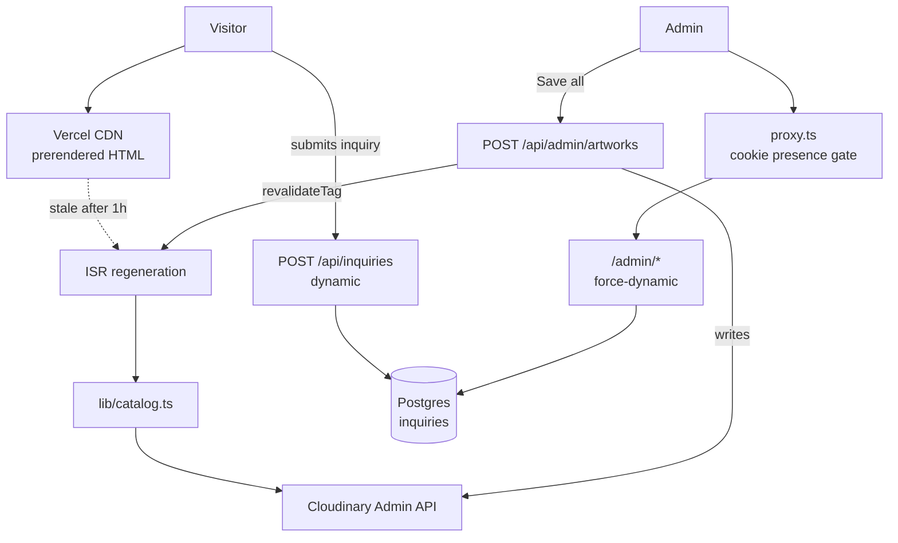

# architecture.md — how saadbhatti.studio is put together

> **⚠️ Partially stale.** This file is current as of Phase D and predates the likes,
> settings, event-streaming, rate-limiting, and semantic-search work. For current
> system state see [system-overview.md](system-overview.md); this remains useful as a
> deeper structural reference for the parts it does cover.

The structural reference for this codebase: what each directory is for, where data
comes from, how requests flow, and which invariants must not be broken. Current as
of **Phase D** (private inquiries / comment log).

How this fits with the other docs:

| Doc | Answers |
|---|---|
| **architecture.md** (this) | *How is it built?* Structure, layers, data flow, invariants. |
| [README.md](../README.md) | *How do I run/deploy it?* Commands, credentials, content workflow. |
| [learnings.md](learnings.md) | *How do I think about it?* Front-end concepts for a backend engineer, and the hard-won Cloudinary/serverless lessons. |
| [saadbhattistudioPlan(refined).md](saadbhattistudioPlan(refined).md) | *What is it supposed to be?* Product spec, views, phasing. |

---

## 1. The shape of the system

A Next.js 16 App Router site on Vercel. Two architectural bets explain nearly
every decision downstream.

### Bet 1 — Cloudinary is the source of truth for artwork

There is no CMS and no artwork table. The **Cloudinary folder tree literally is
the site structure**, and the site is derived from it at build time:

```
Cloudinary folders            →   Site
─────────────────────────────────────────────────────
/photography            (root folder)   →  a medium      → /photography
/photography/SouthWest  (subfolder)     →  a collection  → /photography/southwest
  01-colorado_iejdgb.jpg (asset)        →  an artwork    → …/southwest#01-colorado-iejdgb
```

Add a root folder in Cloudinary and a new medium appears in the sidebar. Nothing
in the code is medium-specific — `photography` and `paintings` are not named
anywhere in `lib/` or `app/`. Consequences:

- **Ordering** is alphabetical by filename, which is why files carry `01-`, `02-`
  prefixes and why "reorder" means *renaming files*, not updating a database.
- **Titles and metadata** live in Cloudinary's contextual metadata, which is why
  the admin editor writes back to Cloudinary rather than to a database.
- **The build is an ETL job.** `next build` reads the Cloudinary Admin API,
  transforms it into a catalog, and emits static HTML.

### Bet 2 — Static public site, dynamic admin, one app

The public site is fully prerendered and revalidates hourly. The admin surfaces
are server-rendered per request. Both live in the same Next app, and the seam
between them is guarded carefully — the recurring design pressure in this
codebase is *keeping admin concerns from making public pages dynamic*.



The two write targets never mix: **artwork data goes to Cloudinary, inquiry data
goes to Postgres.** Nothing about an artwork is stored in the database except an
opaque reference and a display snapshot.

---

## 2. Directory map

| Path | Purpose | What belongs here |
|---|---|---|
| `app/` | Routes. Every folder is a URL segment; `page.tsx` makes it routable. Server Components by default. | Route files, route-scoped Server Actions (`actions.ts`), API route handlers, the root layout, global CSS. |
| `app/api/` | HTTP endpoints (Route Handlers). `POST`/`GET` exports rather than pages. | JSON endpoints. `app/api/admin/*` is auth-gated by the proxy matcher; `app/api/inquiries` is deliberately **outside** it. |
| `components/` | Reusable UI. Mixed server and client — a `"use client"` at the top is the distinction. | Presentational + interactive pieces. Nothing that talks to Cloudinary or the DB directly. |
| `lib/` | The non-UI layer: data access, domain model, auth, helpers. Where the "backend" lives. | Anything importable by routes/components. Server-only modules (DB, Cloudinary secrets) must never be imported by a client component. |
| `prisma/` | Database schema and migration history. | `schema.prisma` + the committed `migrations/` folder. Generated client output is **not** here (it goes to `node_modules`). |
| `content/` | Site text only — title, intro, bio, contact, hero/headshot refs. | Copy edits. **Not** artwork data; that's Cloudinary's job. |
| `public/` | Static files served verbatim at the site root. | `images/hero.jpg`, `headshot.jpg`, `siteBorder.png` (the carpet frame). Referenced by a leading `/`. |
| `docs/` | Planning + reference documents. Not shipped. | Specs, this doc, learnings, Q&A history. |
| `collector/` | Python/FastAPI service (Kafka event ingest). Deployed separately, on the EC2 box — Vercel never builds it. | `main.py`, `Dockerfile`, `requirements.txt`. See [system-overview.md §9](system-overview.md#9-kafka-event-streaming--k1--k2--k3-). |
| `embed/` | Python/FastAPI CLIP embedder — an on-demand container, not a standing service. Writes `artwork_embeddings`. | `main.py`, `Dockerfile`, `requirements.txt`. See [system-overview.md §8](system-overview.md#8-semantic-image-search-) and [operations.md §1](operations.md#1-re-indexing-search). |
| `.claude/` | Agent tooling config (`launch.json` = dev-server definition for the preview tools). | Not application code. |

Root files worth knowing: `proxy.ts` (the middleware — see §8), `docker-compose.yml`
(local Postgres, plus the `streaming` and `embedding` profiles), `next.config.ts`
(38 lines — ships the ONNX native runtime the CLIP text encoder needs at build
time; see [system-overview.md §8](system-overview.md#8-semantic-image-search-)),
`postcss.config.mjs` (Tailwind v4 entry point), `tsconfig.json` (defines the
`@/*` → project-root alias used by every import).

---

## 3. Sources of truth

Four stores, strictly separated. Knowing which owns what prevents most mistakes.

| Store | Owns | Written by | Read by |
|---|---|---|---|
| **Cloudinary** (`sbh111`) | Mediums, collections, artworks, images, titles, metadata, order | Admin UI → `POST /api/admin/artworks`; Saad uploading directly | `lib/catalog.ts` at build/ISR |
| **Postgres** (Neon prod / Docker local) | Inquiries, likes, settings, rate-limit windows, CLIP embeddings — five tables now, not one; see [schema-design.md](schema-design.md) | API routes; the CLIP embedder | `/admin/comments`, `/admin/likes`, `/admin/settings`, `/api/search` |
| **`content/content.json`** | Site text (title, intro, bio, contact, hero/headshot refs) | Hand-edited, committed | `lib/content.ts` |
| **`public/`** | Hero, headshot, border image | Committed files | Anything with a `/`-leading src |

The rule that keeps these apart: **an inquiry references an artwork only by
Cloudinary `public_id`**, plus a title *snapshot* taken server-side at submission.
No foreign keys into Cloudinary, no artwork rows. That's what lets the comment log
survive an artwork being renamed, reordered, or deleted.

---

## 4. The data layer — `lib/`

| File | Role |
|---|---|
| `catalog.ts` | **The domain model.** Turns Cloudinary's folder tree into `CatalogMedium[] → CatalogCollection[] → CatalogArtwork[]`. Also exposes `getArtworkIndex()` (flat `public_id → artwork + location` map). |
| `cloudinaryAdmin.ts` | Low-level authenticated Admin API client. Everything that reads or **mutates** Cloudinary. Holds the API key/secret. |
| `cloudinary.ts` | Pure URL builders for image delivery (`imageUrl`, `imageSrcSet`, `blurUrl`) + `CLOUD_NAME`. No secrets — safe anywhere. |
| `content.ts` | Types + loads `content.json`. |
| `nav.ts` | Builds the sidebar tree from the catalog (`buildNavTree`) and the admin node (`buildAdminNavNode`). Pure, serializable. |
| `auth.ts` | Session (iron-session), `isAdmin()`, `verifyCredentials()`. Holds bcrypt. |
| `db.ts` | The `PrismaClient` singleton, cached on `globalThis` for dev HMR. Lazy — connects on first query. |
| `inquiries.ts` | Server-only inquiry helpers: `hashIp`, `clientIpOf`, and its own `isRateLimited` (a different arity from `rateLimit.ts`'s — see [tech-debt.md 3.5](tech-debt.md)). Imports Prisma. |
| `inquiryLimits.ts` | Shared constants (lengths, email regex, rate limits) with **no server imports**, so the client form can share the server's numbers without pulling Prisma into the browser bundle. |
| `rateLimit.ts` | The shared Postgres-backed rate limiter (`isRateLimited`) and every bucket's tuning constants (likes, events, search, search-global, the daily email cap). |
| `settings.ts` | Server-only key/value settings (`getSetting`/`setSetting`), plus `isEventStreamingEnabled()` with a ~60s in-process cache on the ingest hot path. |
| `mail.ts` | `sendInquiryNotification()` — the Resend call behind the best-effort inquiry email. Best-effort: warns and no-ops if unconfigured rather than throwing. |
| `collector.ts` | Forwards enriched events to the Kafka collector over HTTP (best-effort, swallows every failure). |
| `eventTypes.ts` | Client-safe event schema (`ClientEvent`, batch/flush constants) shared by the tracker and `/api/events` — same split rationale as `inquiryLimits.ts`. |
| `sessionId.ts` | Client-side per-tab session id (sessionStorage) used to key events and likes. |
| `clip.ts` | The CLIP **text** encoder (transformers.js/ONNX) used by `/api/search`; the image side lives in `embed/`. |
| `constants.ts` | Single-source-of-truth magic values shared across files that must not drift (site origin, cache tag, revalidate window, layout numbers). |

The `inquiries.ts` / `inquiryLimits.ts` split exists solely to enforce that last
point. If you need a constant on both sides, it goes in `inquiryLimits.ts`.

### How the catalog is derived

`getCatalog()` walks Cloudinary and applies these rules (all in `catalog.ts`):

| Concept | Derivation |
|---|---|
| Medium | Root folder. `displayName` = folder name verbatim; URL = slugified. |
| Collection | Subfolder of a medium. Folder name **is** the title. Empty collections are dropped. |
| Membership | Assets whose `asset_folder` is `<medium>/<collection>`. |
| Order | `localeCompare` on `display_name` — hence the `NN-` prefixes. |
| Name | Context `Title Name` → `caption` → prettified filename (strips `NN-`, dashes → spaces). |
| Metadata | Context keys `Film`, `Medium`, `Dimensions`, `Year` (`META_KEYS`), whichever exist, in that order. |
| Cover | First artwork. |
| Aspect | Cloudinary `width/height` — reserves layout space to avoid shift. |

A Cloudinary detail that shapes the code: this account uses **dynamic folders**,
so `public_id` is an opaque, stable string (`01-muyThai_s2deee`), the folder is the
`asset_folder` *attribute*, and the filename is `display_name`. Public ids are not
paths and don't change when you rename or move an asset — which is exactly why
they're used as the stable key everywhere.

---

## 5. Routes — `app/`

| Route | File | Rendering | Auth |
|---|---|---|---|
| `/` | `app/page.tsx` | Static, 1h revalidate | public |
| `/about` | `app/about/page.tsx` | Static | public |
| `/[medium]` | `app/[medium]/page.tsx` | SSG via `generateStaticParams` | public |
| `/[medium]/[collection]` | `app/[medium]/[collection]/page.tsx` | SSG via `generateStaticParams` | public |
| `/admin/login` | `app/admin/login/page.tsx` | Dynamic | public (the way in) |
| `/admin/comments` | `app/admin/comments/page.tsx` | `force-dynamic` | admin |
| `/admin/likes` | `app/admin/likes/page.tsx` | `force-dynamic` | admin |
| `/admin/settings` | `app/admin/settings/page.tsx` | `force-dynamic` | admin |
| `POST /api/admin/artworks` | route handler | Dynamic | admin |
| `GET /api/admin/session` | route handler | Dynamic | public (returns a bare boolean) |
| `POST /api/inquiries` | route handler | Dynamic | public |
| `POST` / `DELETE /api/likes` | route handler | `force-dynamic` | public (no-op if admin) |
| `POST /api/events` | route handler | `force-dynamic` | public (no-op if admin; always 204) |
| `GET /api/events/config` | route handler | `force-dynamic` | public (returns `{enabled}`) |
| `GET /api/catalog-index` | route handler | `force-dynamic` | bearer token (`CATALOG_INDEX_TOKEN`) — a machine caller (the embedder), not a browser, so it's outside `/api/admin` on purpose |
| `POST /api/search` | route handler | `force-dynamic`, Node runtime | public, rate-limited |
| `GET /api/health` | route handler | `force-dynamic` | public — see [operations.md §3](operations.md#3-monitoring) |

`app/layout.tsx` is the root: fonts, metadata, `revalidate = 3600`, and it builds
the nav tree server-side, wrapping everything in `AdminProvider` → `AppShell`.
`app/template.tsx` re-mounts per navigation purely to give each view a fade-in.

There is **no `/admin` page** — the admin nav entry is an expand-only parent. The
admin surface is: inline editing on collection pages, the bottom bar, the reorder
panel, and the comment log.

---

## 6. Components

Server components (no `"use client"`) render on the server and ship no JS:

| Component | Role |
|---|---|
| `ArtworkBlock` | One artwork: image + caption + inquiry form, inside a `<figure>`. |
| `ArtworkImage` | Responsive image, srcset + blur-up, capped so the caption stays on screen (`~66vh` height budget). Handles both local `/` paths and Cloudinary ids. |
| `CollectionCover` | One collection on a medium page. |
| `WIPView` | Placeholder for an empty medium. |
| `InquiryEmailAlert` | Renders the failed/skipped-email banner + resend on a comment-log row. |

Client components (`"use client"` — interactive):

| Component | Role | Consumes |
|---|---|---|
| `AdminProvider` | All client-side admin state. Four contexts (§9). | — |
| `AppShell` | Sidebar + drawer + main + admin bar. Splices the admin nav node. | `useIsAdmin` |
| `NavTree` | Recursive tree: expand/collapse, auto-expand ancestors, cascade-collapse. | — |
| `ArtworkCaption` | Caption; becomes inputs for admins. Holds its own input state for speed. | `useArtworkEdit` |
| `ReorderPanel` | Admin-only, desktop-only drag list (dnd-kit). | `useArtworkOrder` |
| `ReorderableArtworkList` | Live-previews staged order in the main stack by re-emitting server children in staged order. | `useArtworkOrder` |
| `AdminBar` | Bottom bar: label, log out, dirty count, Save all / Discard all. | `useAdminBar` |
| `InquiryForm` | Inline inquiry form; hidden for admins. | `useIsAdmin` |
| `DeleteInquiryButton` | `window.confirm` guard on the delete form. | — |
| `LikeButton` | The like/unlike heart; localStorage-only state, zero network on load, hidden for admins. | — |
| `EventTracker` | Mounted once in `AppShell`; batches clickstream events and flushes via `sendBeacon`. Suppressed for admins, DNT, or the streaming toggle off. | `useIsAdmin` |
| `SearchDrawer` | Full-height slide-in search UI over `/api/search`. | — |

`ReorderableArtworkList` is the subtlest piece: it takes the *server-rendered*
children and re-emits them in the staged order. React reconciles by key, so
thumbnails slide without reloading, and for visitors it returns children untouched —
byte-identical SSG, zero hydration mismatch.

---

## 7. Rendering & caching

Three cooperating layers:

1. **Fetch cache** — `apiGet()` in `cloudinaryAdmin.ts` tags every Cloudinary read
   with `next: { revalidate: 3600, tags: ["catalog"] }`.
2. **Route revalidation** — `revalidate = 3600` in the root layout.
3. **React `cache()`** — `getCatalog()` and `getArtworkIndex()` are deduped
   per render, so a page that needs the catalog three times fetches once.

Publishing an admin change is therefore *cache invalidation*, not a deploy:

```
Save all → POST /api/admin/artworks → write to Cloudinary
        → revalidateTag("catalog", "max")   // drop cached Cloudinary reads
        → revalidatePath("/", "layout")     // drop rendered HTML
        → router.refresh()                  // pull the new server render
```

> **Next 16 note:** `revalidateTag` takes **two** arguments here. Writing the
> one-arg form silently does nothing useful.

Writes deliberately bypass the cache: `apiGetFresh()` (`cache: "no-store"`) is used
before every mutation so a read-merge-write starts from live state.

---

## 8. Auth & trust boundaries

Single admin, no user table. The session is a signed+encrypted HttpOnly cookie
(`sbh_admin_session`, iron-session) carrying one flag. Credentials are an env-var
username plus a bcrypt hash.

**Two layers, and only one of them is a security boundary:**

| Layer | File | Checks | Is it authoritative? |
|---|---|---|---|
| Proxy (middleware) | `proxy.ts`, matcher `/admin/:path*`, `/api/admin/:path*` | Cookie **presence** only | **No** — UX/latency only |
| Session check | `lib/auth.ts` `isAdmin()` | Unseals + verifies the cookie | **Yes** |

Every protected page and handler calls `isAdmin()` itself regardless of the proxy.
The proxy exists to bounce logged-out users to the login page quickly and to 401
admin API calls cheaply — it must never be the only thing standing between a
request and a mutation. The comment-log Server Actions re-check `isAdmin()` for
exactly this reason.

Two deliberate consequences:

- `POST /api/inquiries` sits **outside** the matcher (it's public by design).
  Putting it under `/api/admin/` would have 401'd every visitor.
- `proxy.ts` duplicates the cookie name as a literal rather than importing
  `lib/auth.ts` — importing it would drag bcryptjs into the edge bundle. The two
  must be kept in sync by hand.

---

## 9. Client state — `AdminProvider`

Admin edits are **staged locally, then bulk-published**. Nothing hits Cloudinary
until "Save all". Staging lives in `localStorage` (`sbh_admin_edits`,
`sbh_admin_order`), so it survives refreshes and navigation between collections.

The provider is split into four contexts purely by *churn profile* — a single
context would re-render every caption on every keystroke:

| Context | Hook | Identity changes when | Consumers |
|---|---|---|---|
| `EditContext` | `useArtworkEdit` | Hydration + discard (`syncSignal`) | every caption |
| `OrderContext` | `useArtworkOrder` | Every drop (`orderVersion`) | reorder panel, reorderable list |
| `BarContext` | `useAdminBar` | Every keystroke (`dirtyCount`) | the admin bar only |
| `AdminStatusContext` | `useIsAdmin` | Login/logout only | nav splice, inquiry form |

Staged values live in **refs**, not state — mutating a ref doesn't re-render, so
the counters above are what drive the UI, deliberately and narrowly.

`isAdmin` is resolved client-side by one small fetch to `/api/admin/session`
(re-run on route change), because the cookie is HttpOnly and unreadable from JS.
This is the load-bearing trick that keeps the public site static: **reading the
session in the root layout would make every page dynamic.** Instead the server
renders the public tree, and the client splices the admin node in after hydration.

### Save-all semantics

Failures don't lose work. Failed edits stay staged; reorders self-clear only once
the server confirms the new order (avoiding an order "flash"); reorders are
idempotent, so retrying heals a partial apply. A reorder whose collection changed
underneath is rejected as **stale** rather than merge-guessed — bulk renames are
destructive.

---

## 10. The three write paths

**1. Admin bulk save** — `POST /api/admin/artworks`
```
isAdmin → parse {edits, reorders}
        → edits:    read-merge-write Cloudinary context (parallel, allSettled)
        → reorders: renumber NN- prefixes sequentially (ok | stale | error)
        → revalidateTag + revalidatePath
        → report {savedEdits, failedEdits, savedReorders, failedReorders}
```
Context updates **replace** the whole custom context in Cloudinary (verified the
hard way), so `updateArtworkContext` reads current context first and merges;
`""` deletes a key, unrelated keys survive. Renames use the Admin API's update
endpoint, never the Upload API's `rename`, so `public_id` never changes.

**2. Public inquiry** — `POST /api/inquiries`
```
parse/trim → honeypot `website` filled? → 200 {ok:true}, no DB write
           → validate name/email/message lengths + email shape → 400 "invalid"
           → artworkPublicId must exist in getArtworkIndex() → 400
             (and its title is snapshotted from there — never from the client)
           → rate limit: sha256(ip + IP_HASH_SALT), ≥5 in 10min → 429
           → insert → 201
```
Every rejection is terse and identical in shape — enumerating *why* only helps
bots. The honeypot mimics success exactly. Rate limiting is **DB-backed** because
in-memory counters are per-instance on serverless, i.e. useless.

**3. Comment log mutations** — Server Actions in `app/admin/comments/actions.ts`
(`toggleReadAction`, `deleteInquiryAction`): `isAdmin()` guard → single-row
Prisma write → `revalidatePath("/admin/comments")`.

---

## 11. Database

**Five tables now, not one** — `inquiries` (this section's original subject),
plus `likes`, `settings`, `rate_windows`, and `artwork_embeddings` added by the
likes/streaming, rate-limiting, and search work. Schema in `prisma/schema.prisma`,
history in `prisma/migrations/` (committed — the migration folder *is* the
schema's audit trail). **Full reference:** [schema-design.md](schema-design.md)
— this section keeps only the original `inquiries` detail, which is still
accurate.

```
Inquiry → table "inquiries"
  id               cuid
  artworkPublicId  varchar(255)   -- the ONLY artwork key
  artworkTitle     varchar(255)   -- server-resolved snapshot
  name/email/message
  status           NEW | READ
  emailStatus      PENDING | SENT | SKIPPED | FAILED   -- notification outcome
  emailError       varchar(500), nullable
  ipHash           varchar(64)    -- sha256(ip + IP_HASH_SALT); never a raw IP
  createdAt
  @@index([createdAt desc])       -- the log's ordering
  @@index([ipHash, createdAt])    -- dead: no query filters by ipHash any more
                                   -- (see schema-design.md §7)
```

No `updatedAt`, no soft delete — status plus hard delete is the entire
lifecycle.

**Pooled vs direct connections.** Prisma is configured with two URLs because they
do different jobs:

| Var | Host | Used by | Why |
|---|---|---|---|
| `DATABASE_URL` | Neon `-pooler`, `?…&pgbouncer=true` | the running app | Serverless spawns many instances; PgBouncer multiplexes them. `pgbouncer=true` disables prepared statements, which transaction pooling can't support. |
| `DIRECT_URL` | Neon direct | `prisma migrate` | Migrations need a real session (advisory locks, DDL) that transaction pooling breaks. |

`prisma generate` runs via `postinstall` (Vercel caches `node_modules`).
**Migrations are never run in the build** — `npx prisma migrate deploy` is manual,
so content redeploys stay decoupled from database availability. `lib/db.ts`
connects lazily, which is what lets `next build` succeed with no database at all.

---

## 12. Environment & configuration

| Var | `.env` | `.env.local` | Vercel | Used by |
|---|---|---|---|---|
| `DATABASE_URL` | local Docker | — | Neon pooled | Prisma |
| `DIRECT_URL` | local Docker | — | Neon direct | Prisma migrate |
| `CLOUDINARY_API_KEY` / `_SECRET` | — | ✓ | ✓ | `cloudinaryAdmin.ts` |
| `ADMIN_USERNAME` / `ADMIN_PASSWORD_HASH` | — | ✓ | ✓ | `auth.ts` |
| `SESSION_SECRET` | — | ✓ | ✓ | `auth.ts` |
| `IP_HASH_SALT` | — | ✓ | ✓ | `inquiries.ts` |
| `RESEND_API_KEY` / `INQUIRY_NOTIFY_FROM` / `INQUIRY_NOTIFY_TO` | — | ✓ | ✓ | `mail.ts` (best-effort — unset just skips the send) |
| `EVENT_COLLECTOR_URL` / `EVENT_INGEST_TOKEN` | — | ✓ | ✓ (+ EC2 `deploy/.env`) | `collector.ts` (send) / `collector/main.py` (check) |
| `CATALOG_INDEX_TOKEN` | — | ✓ | ✓ | `app/api/catalog-index/route.ts` + the embedder |
| `EMBED_TOKEN` / `EMBED_DATABASE_URL` / `MODEL_ID` / `MODEL_REVISION` | — | — | embedder env only (`docker-compose.yml`) | `embed/main.py` |
| `INGEST_DOMAIN` | — | — | EC2 `deploy/.env` only | `deploy/compose.prod.yml` (Caddy TLS) |
| `KAFKA_BOOTSTRAP` / `KAFKA_TOPIC` | — | — | collector env, defaulted | `collector/main.py` |

This table covers the Next app's own config surface. For the **complete** list
— including every Python-service and compose-only variable, what breaks when
each is wrong, and rotation order for the two tokens that live in two places —
see [operations.md §2](operations.md#2-secrets).

**Why two files:** the **Prisma CLI reads `.env` and never `.env.local`**, while
Next reads both (`.env.local` wins per-variable). Database URLs therefore live in
`.env`; everything else in `.env.local`. Both are gitignored; `.env.example` and
`.env.local.example` are the committed, value-free templates.

Two traps worth internalizing:

- **`$` in a local env value must be escaped as `\$`.** dotenv-expand runs in both
  Next and Prisma, and quoting does *not* protect you — this silently mangles
  bcrypt hashes. Vercel's dashboard takes raw values.
- **Real environment variables beat `.env` in Prisma's precedence.** That's what
  makes the manual production-migrate one-liner work — and why a shell that ran it
  is still pointed at production afterward.

Missing-credential errors are raised deliberately with instructions
(`auth.ts`, `cloudinaryAdmin.ts`, `inquiries.ts`) rather than failing obscurely.

---

## 13. Invariants — don't break these

1. **`public_id` is the stable key.** Never rename via the Upload API. Staged
   edits, delivery URLs, and inquiry rows all point at it.
2. **Public routes must stay static.** No session reads, no DB calls, no
   `cookies()`/`headers()` in the public render path. Check the `npm run build`
   route table: public routes must stay `○`/`●`, admin `ƒ`.
3. **The proxy is not a security boundary.** Every protected page/handler calls
   `isAdmin()` itself.
4. **`/api/inquiries` must stay outside `/api/admin/`.**
5. **Server-resolved snapshots.** Artwork titles on inquiries come from the
   catalog, never from the client payload.
6. **Never store a raw IP.** Only the salted hash.
7. **Secrets never enter committed files.** Example files hold placeholders only.
8. **Never delete Cloudinary assets** — that's the real, only copy of production
   artwork data.
9. **`inquiryLimits.ts` stays import-free** of anything server-only.

---

## 14. Extension points

The Phase D substrate was built to be reused:

- **A new medium or collection** — create the folder in Cloudinary. No code.
- **A new admin log** (e.g. orders): add a model with the same shape
  (`artworkPublicId` + snapshots + status enum) via one migration, add a child to
  `buildAdminNavNode()` (NavTree needs no changes), and copy the
  `/admin/comments` page + Server Actions pattern.
- **A new public write endpoint** — the honeypot → validate → catalog-check →
  rate-limit → insert pipeline in `app/api/inquiries/route.ts` is the template.
- **A new artwork metadata field** — add to `META_KEYS` in `catalog.ts` and
  `FIELD_KEYS` in `AdminProvider.tsx`.

---

## 15. Known rough edges

- **No unread badge** on the admin nav: it would put a DB query on every session
  re-check. A `/api/admin/inquiries/count` endpoint is the intended fix.
- **The comment log caps at 200 rows** with a footnote; pagination is deferred.
- **Untitled artworks** display a filename-derived name (`muyThai s2deee`), which
  is what the comment log will show until a `Title Name` context value is set.
- **Email notification on new inquiries has shipped** (Resend, best-effort,
  fired after the row is committed) — this section originally called it out of
  scope; see [system-overview.md §5](system-overview.md#5-inquiries-and-email-notifications-)
  for how it works.
