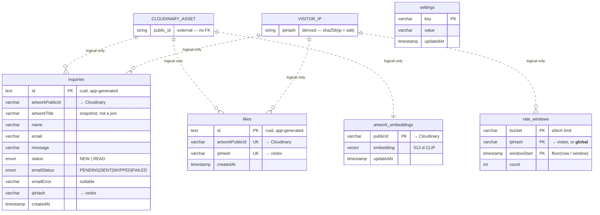

# Schema design — Postgres

The database behind [saadbhatti.studio](https://saadbhatti.studio): five tables on Neon Postgres,
reached through Prisma. This document explains **why the schema looks the way it does** and serves
as a **reference** for what is actually in it.

All DDL below is reproduced verbatim from `prisma/migrations/`. For how each table is *used* by
each feature, see [system-overview.md](system-overview.md).

---

## 1. Design principles

Five ideas account for most of the schema.

**The parent entity lives in another system.** Artworks are Cloudinary assets. There is no
`artworks` table to point at, so there are **no foreign keys anywhere in this database** — every
artwork reference is a Cloudinary `public_id` stored as a plain string. Referential integrity is
something the application reasons about, not something Postgres enforces.

**Snapshot instead of join.** Because there is nothing to join *to*, an inquiry stores the artwork
title it was made about. The record survives a rename, a re-crop, or a deletion — and a
client-supplied title never reaches the admin UI.

**Count requests, not rows.** Rate limiting can't be derived from domain tables, because the
requests worth limiting often produce no row at all: a deduplicated like, an unlike, a forwarded
analytics batch. A dedicated counter table measures traffic directly.

**Pseudonymous correlation, not identity.** There are no users and no sessions in the database.
Where the system needs to recognise "the same visitor again", it stores a salted SHA-256 of the IP
and never the address itself.

**One table per concern.** No table references another. Each can be truncated, migrated, or
dropped without touching the rest — which is what makes the optional subsystems genuinely optional.

---

## 2. The key map



Dotted lines are **logical mappings the database does not enforce**. The two boxes at the top are
not tables — one is an external service, the other is a derived value. `settings` connects to
nothing at all.

### Four kinds of key

| Kind | Where | Why |
|---|---|---|
| **Surrogate** — `text` cuid | `inquiries.id`, `likes.id` | Rows with no natural identity. Generated by the application, so a hand-written `INSERT` must supply one. |
| **External natural** — Cloudinary `public_id` | `inquiries`, `likes`, `artwork_embeddings` | The one artwork identifier that never changes. Titles, filenames and folders are all editable; `public_id` is not. |
| **Derived pseudonym** — `ipHash` | `inquiries`, `likes`, `rate_windows` | Enables "same visitor" logic — dedup and rate limiting — with no personal data at rest. |
| **Composite natural** | `rate_windows (bucket, ipHash, windowStart)` | The tuple *is* the identity of a counter. No surrogate id, and the PK doubles as the upsert target. |

---

## 3. Table reference

### `inquiries`

```sql
CREATE TYPE "InquiryStatus" AS ENUM ('NEW', 'READ');

CREATE TABLE "inquiries" (
    "id" TEXT NOT NULL,
    "artworkPublicId" VARCHAR(255) NOT NULL,
    "artworkTitle" VARCHAR(255) NOT NULL,
    "name" VARCHAR(100) NOT NULL,
    "email" VARCHAR(254) NOT NULL,
    "message" VARCHAR(2000) NOT NULL,
    "status" "InquiryStatus" NOT NULL DEFAULT 'NEW',
    "ipHash" VARCHAR(64) NOT NULL,
    "createdAt" TIMESTAMP(3) NOT NULL DEFAULT CURRENT_TIMESTAMP,

    CONSTRAINT "inquiries_pkey" PRIMARY KEY ("id")
);

CREATE INDEX "inquiries_createdAt_idx" ON "inquiries"("createdAt" DESC);
CREATE INDEX "inquiries_ipHash_createdAt_idx" ON "inquiries"("ipHash", "createdAt");
```

A later migration added email-outcome tracking:

```sql
CREATE TYPE "EmailStatus" AS ENUM ('PENDING', 'SENT', 'SKIPPED', 'FAILED');

ALTER TABLE "inquiries" ADD COLUMN     "emailError" VARCHAR(500),
ADD COLUMN     "emailStatus" "EmailStatus" NOT NULL DEFAULT 'PENDING';

UPDATE "inquiries" SET "emailStatus" = 'SENT';
```

**Notes.** Column widths mirror the validation bounds enforced in the API, so the database is a
second line of defence rather than the only one. `emailStatus` makes a failed notification a
*visible, recoverable* state instead of a silent drop — the admin log surfaces it with the stored
`emailError` and a resend action. The backfill exists so historical rows don't appear as failures.

Because those two columns arrived by `ALTER TABLE`, their **physical position is last**, not where
they appear in the ORM model — `\d inquiries` will not match `schema.prisma` field order.

### `likes`

```sql
CREATE TABLE "likes" (
    "id" TEXT NOT NULL,
    "artworkPublicId" VARCHAR(255) NOT NULL,
    "ipHash" VARCHAR(64) NOT NULL,
    "createdAt" TIMESTAMP(3) NOT NULL DEFAULT CURRENT_TIMESTAMP,

    CONSTRAINT "likes_pkey" PRIMARY KEY ("id")
);

CREATE INDEX "likes_artworkPublicId_idx" ON "likes"("artworkPublicId");
CREATE UNIQUE INDEX "likes_artworkPublicId_ipHash_key" ON "likes"("artworkPublicId", "ipHash");
```

**Notes.** The unique index is the whole dedup mechanism: a second like raises a uniqueness
violation, which the route catches and converts into a normal success response. Idempotency is
enforced by the database rather than by a read-then-write race in the application.

Worth being precise about a claim the code comments once made: this constraint caps **stored
rows**, not **request volume**. A script can still hammer the endpoint and pay a round trip per
rejected insert. That gap is what `rate_windows` closes.

### `rate_windows`

```sql
CREATE TABLE "rate_windows" (
    "bucket" VARCHAR(64) NOT NULL,
    "ipHash" VARCHAR(64) NOT NULL,
    "windowStart" TIMESTAMP(3) NOT NULL,
    "count" INTEGER NOT NULL DEFAULT 0,

    CONSTRAINT "rate_windows_pkey" PRIMARY KEY ("bucket", "ipHash", "windowStart")
);

CREATE INDEX "rate_windows_windowStart_idx" ON "rate_windows"("windowStart");
```

**Notes.** A fixed-window counter. `windowStart` is computed by the application as
`floor(now / windowMs) * windowMs`, so no timer or scheduled job is needed — the window boundary
falls out of arithmetic. The single statement against this table is an upsert with
`count: { increment: 1 }`, which is atomic at the row level and therefore free of the
count-then-write race a naive implementation would have.

Postgres was chosen over an in-process counter because each serverless invocation is a fresh
instance with no shared memory — and over Redis because it needed no new infrastructure.

Six buckets are in use: `inquiry`, `inquiry_email`, `like`, `events`, `search`, `search_global`.
Two of them (`inquiry_email`, `search_global`) use the literal `ipHash` value `"__global__"` to
express a site-wide ceiling rather than a per-visitor one — the same table serving both fairness
and cost control. `bucket` is an unconstrained `varchar` with no `CHECK`, so a typo silently
creates a new, permanently-empty namespace that never limits anything.

### `artwork_embeddings`

```sql
CREATE EXTENSION IF NOT EXISTS vector;

CREATE TABLE "artwork_embeddings" (
    "publicId" VARCHAR(255) NOT NULL,
    "embedding" vector(512) NOT NULL,
    "updatedAt" TIMESTAMP(3) NOT NULL,

    CONSTRAINT "artwork_embeddings_pkey" PRIMARY KEY ("publicId")
);
```

**Notes.** One row per artwork, keyed directly by the Cloudinary id — no surrogate. 512 dimensions
because that is CLIP ViT-B/32's projection width. See §6 for how a column the ORM cannot express
gets read and written.

### `settings`

```sql
CREATE TABLE "settings" (
    "key" VARCHAR(64) NOT NULL,
    "value" VARCHAR(255) NOT NULL,
    "updatedAt" TIMESTAMP(3) NOT NULL,

    CONSTRAINT "settings_pkey" PRIMARY KEY ("key")
);
```

**Notes.** A generic key/value flag store holding exactly one key today
(`event_streaming_enabled`). Values are strings, not booleans, so future flags need no migration.
Reads are cached in-process for ~60 seconds because the flag sits on an ingest hot path; the
trade-off is that a toggle propagates within the TTL rather than instantly across serverless
instances.

---

## 4. Access patterns → indexes

Every query in the codebase, and the index that serves it.

| Table | Query | Predicate | Index used | Path |
|---|---|---|---|---|
| `inquiries` | `create` | — | — | hot |
| `inquiries` | `update` (email outcome) | `id` | PK | background |
| `inquiries` | `findMany` | `ORDER BY createdAt DESC LIMIT 200` | `inquiries_createdAt_idx` | admin |
| `inquiries` | `findUnique` / `update` / `delete` | `id` | PK | admin |
| `likes` | `create` | uniqueness check | `likes_artworkPublicId_ipHash_key` | hot |
| `likes` | `deleteMany` | `artworkPublicId, ipHash` | `likes_artworkPublicId_ipHash_key` | hot |
| `likes` | `groupBy` + count | none | full scan | admin |
| `rate_windows` | `upsert … increment` | `bucket, ipHash, windowStart` | PK | **hottest** |
| `artwork_embeddings` | raw `SELECT … ORDER BY <=>` | cosine, `LIMIT 5` | none — seq scan | hot |
| `artwork_embeddings` | raw `INSERT … ON CONFLICT` | `publicId` | PK | offline |
| `artwork_embeddings` | raw `DELETE … <> ALL` | prune | PK-ish scan | offline |
| `settings` | `findUnique` / `upsert` | `key` | PK | hot (cached) / admin |

Two observations fall out of this table. **`likes` is write-only on the hot path** — there is no
public read, no like count endpoint; the heart is optimistic on the client. And **two indexes serve
nothing**, covered in §7.

---

## 5. Identifiers, time, and types

**Ids are generated by the application.** `inquiries.id` and `likes.id` are `TEXT` holding a cuid,
with no database default. Anything inserting directly via SQL must supply one.

**Timestamps carry no timezone.** Every column is `TIMESTAMP(3)` — millisecond precision, no
offset. Two different clocks write them: `createdAt` uses the *database* clock via
`DEFAULT CURRENT_TIMESTAMP`, while `rate_windows.windowStart` is computed from the *Node* clock in
whichever serverless instance handled the request. Neon runs UTC so these agree in practice, but
window boundaries are ultimately derived from application clocks spread across many instances, not
from a single authority — acceptable for a coarse rate limiter, and worth knowing before anything
finer depends on it.

**`updatedAt` has no database default and no trigger.** It is maintained entirely by the
application. On `settings` the ORM fills it; on `artwork_embeddings` the ORM annotation is
effectively decorative, because Prisma never writes that table — the Python embedder passes
`now()` explicitly in both branches of its upsert. A hand-written `INSERT INTO settings` would fail
the `NOT NULL`, since nothing in the database supplies the value.

**Enums are real Postgres types**, not check constraints or strings — so an invalid status is
rejected by the database, and adding a value is a migration.

---

## 6. pgvector

Prisma has no vector type, so the column is declared `Unsupported("vector(512)")`. The typed client
can never select or write it — and because the field is required *and* unsupported, Prisma cannot
create a row in this table at all. Both sides are therefore raw SQL.

**Read** (search route, hot path) — the vector and the score floor are **bound parameters**, never
string-concatenated; the cast to `::vector` happens in SQL:

```sql
SELECT "publicId"
FROM "artwork_embeddings"
WHERE 1 - (embedding <=> $1::vector) >= $2
ORDER BY embedding <=> $1::vector
LIMIT 5
```

**Write** (Python embedder, offline):

```sql
INSERT INTO artwork_embeddings ("publicId", embedding, "updatedAt")
VALUES (%s, %s, now())
ON CONFLICT ("publicId") DO UPDATE
SET embedding = EXCLUDED.embedding, "updatedAt" = now()
```

**The load-bearing invariant is model parity.** Two different languages write and read this column
— PyTorch on the way in, transformers.js on the way out — and the numbers are only comparable
because both use the same CLIP variant and both L2-normalize, which is what makes `<=>` cosine
distance meaningful. The database cannot check this; a mismatch produces plausible-looking garbage.

**There is no ANN index.** No HNSW, no IVFFlat. Every search sequentially scans the table,
computing a 512-dimension distance per row, then sorts. That is exact recall and O(n) per query —
entirely appropriate for a catalog of dozens, and stated here so nobody assumes otherwise. If the
catalog grew by orders of magnitude, an HNSW index on `vector_cosine_ops` would be the fix, with
one caveat: the `WHERE 1 - (embedding <=> …) >= threshold` predicate is not index-sargable, so it
would run as a filter over the ANN-ordered scan and could under-fill the `LIMIT`.

---

## 7. Growth, retention, and known issues

Listed worst-first, each with its fix.

**`rate_windows` grows forever.** The only statement against the table is the upsert; nothing ever
deletes. Roughly one row per (bucket, distinct IP, window) accumulates indefinitely. The
`rate_windows_windowStart_idx` index exists *specifically* to support a sweeper — which was never
written. **Fix:** a periodic `DELETE FROM rate_windows WHERE "windowStart" < now() - interval '1 day'`.

**`inquiries_ipHash_createdAt_idx` is dead weight.** It was created for the original rate limiter,
which counted recent inquiry rows for an IP. That limiter was replaced by `rate_windows`, and **no
query filters inquiries by `ipHash` any more** — the column is now write-only. The index costs
write amplification on every insert and serves nothing. **Fix:** drop it, or keep it deliberately
for ad-hoc forensic lookups and say so.

**`likes_artworkPublicId_idx` is redundant.** Its column is the leading column of
`likes_artworkPublicId_ipHash_key`, which Postgres can use for the same lookups. Two indexes are
maintained where one would do; the ORM emitted both because the index and the unique constraint are
declared separately. **Fix:** drop the single-column index.

**The `"__global__"` rows are write hotspots.** Every search and every inquiry email funnels
through one row per window, so concurrent requests serialize on that row lock. This is the intended
cost-ceiling mechanism, but it converts a distributed flood into lock contention on a pooled
connection — and since the limiter fails open, a lock timeout silently disables the ceiling rather
than rejecting traffic. **Fix if it ever bites:** shard the global counter across N rows and sum.

**No index on `emailStatus`.** The admin log fetches 200 rows and filters in JavaScript. Correct at
this scale — noted so nobody later writes `WHERE "emailStatus" = 'FAILED'` expecting index support.

**The admin likes aggregate is a full scan.** It groups the entire table with no `WHERE` and no
limit. Trivial today; scales linearly with total likes.

**`inquiries` has no retention policy.** Rows are deleted only one at a time by the admin, and the
log shows only the most recent 200 with no pagination — older rows become invisible but resident.

---

## 8. Operations

**Three connection strings, three jobs.**

| Variable | Target | Used by |
|---|---|---|
| `DATABASE_URL` | Neon pooled endpoint | Every runtime query. Pooling mode requires disabling prepared statements. |
| `DIRECT_URL` | Neon direct endpoint | `prisma migrate` only — DDL and advisory locks need a real session. |
| `EMBED_DATABASE_URL` | Direct endpoint | The Python embedder container, which connects independently. |

**Migrations are run manually** (`npx prisma migrate deploy`), deliberately decoupled from the
build. Combined with a lazily-connected client singleton, this means a production build never needs
a reachable database — and a deploy can never half-apply a migration.

**Migration history doubles as a project timeline:** `init_inquiries` → `add_settings_and_likes` →
`add_rate_windows` → `add_inquiry_email_status` → `add_artwork_embeddings`.

---

## 9. What I would change next

1. **Add the `rate_windows` sweeper.** It is the only unbounded growth in the system, on the
   hottest write path, and the supporting index already exists.
2. **Drop the two indexes that serve no query.** Both are pure write cost.
3. **Constrain `bucket`** — a `CHECK` or a lookup table would turn a silent typo into an error.
4. **Revisit the vector index** only if the catalog grows by orders of magnitude. Today an exact
   scan is both faster to reason about and more accurate.
