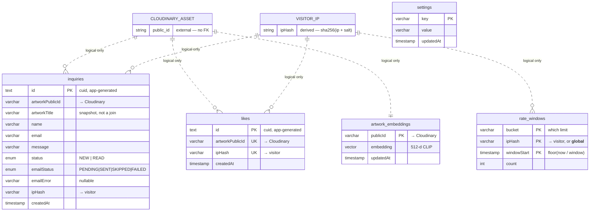

# Schema design — Postgres

The database behind [saadbhatti.studio](https://saadbhatti.studio): six tables on Neon Postgres,
reached through Prisma. This document explains **why the schema looks the way it does** and serves
as a **reference** for what is actually in it.

All DDL below is reproduced verbatim from `prisma/migrations/`. For how each table is *used* by
each feature, see [system-overview.md](system-overview.md).

---

## 1. Design principles

Five ideas account for most of the schema.

**The parent entity lives in another system.** Artworks are Cloudinary assets. There is no
`artworks` table to point at, so there are **no foreign keys among the artwork tables** — every
artwork reference is a Cloudinary `public_id` stored as a plain string. Referential integrity is
something the application reasons about, not something Postgres enforces.

> **This reason is specific to artwork, and does not generalise.** `posts` (added 2026-11-16) is
> a real parent row in this database, so when Phase 2 adds `post_likes` and `post_comments` those
> children **will** carry a real foreign key with `ON DELETE CASCADE`. Carrying the no-FK rule
> into the blog would be cargo-culting a constraint that no longer applies: without the FK,
> deleting a post relies on application code, and a hand-written `DELETE FROM posts` in psql
> would orphan rows silently. Phase 0 ships `posts` alone, so it has no FK simply because it has
> no parent. Note that Prisma's default `relationMode = "foreignKeys"` makes `schema.prisma` the
> source of truth — an FK written only into migration SQL registers as drift — so the relation
> must be declared, even if queries stay explicit.

**Snapshot instead of join.** Because there is nothing to join *to*, an inquiry stores the artwork
title it was made about. The record survives a rename, a re-crop, or a deletion — and a
client-supplied title never reaches the admin UI.

**Count requests, not rows.** Rate limiting can't be derived from domain tables, because the
requests worth limiting often produce no row at all: a deduplicated like, an unlike, a forwarded
analytics batch. A dedicated counter table measures traffic directly.

**Pseudonymous correlation, not identity.** There are no users and no sessions in the database.
Where the system needs to recognise "the same visitor again", it stores a salted SHA-256 of the IP
and never the address itself.

**One table per concern.** No table references another today. Each can be truncated, migrated, or
dropped without touching the rest — which is what makes the optional subsystems genuinely optional.
The blog's child tables (Phase 2) barely dent this: `ON DELETE CASCADE` fires only on *parent*
delete, so `post_likes` stays independently truncatable and droppable; only truncating or dropping
`posts` itself will need `CASCADE`.

---

## 2. The key map



Dotted lines are **logical mappings the database does not enforce**. The two boxes at the top are
not tables — one is an external service, the other is a derived value. `settings` connects to
nothing at all.

### Four kinds of key

| Kind | Where | Why |
|---|---|---|
| **Surrogate** — `text` cuid | `inquiries.id`, `likes.id` | Rows with no natural identity. Generated by the application, so a hand-written `INSERT` must supply one. |
| **External natural** — Cloudinary `public_id` | `inquiries`, `likes`, `artwork_embeddings` | The one artwork identifier that never changes. Titles, filenames and folders are all editable; `public_id` is not. |
| **Derived pseudonym** — `ipHash` | `inquiries`, `likes`, `rate_windows` | Enables "same visitor" logic — dedup and rate limiting — with no personal data at rest. |
| **Composite natural** | `rate_windows (bucket, ipHash, windowStart)` | The tuple *is* the identity of a counter. No surrogate id, and the PK doubles as the upsert target. |

---

## 3. Table reference

### `inquiries`

```sql
CREATE TYPE "InquiryStatus" AS ENUM ('NEW', 'READ');

CREATE TABLE "inquiries" (
    "id" TEXT NOT NULL,
    "artworkPublicId" VARCHAR(255) NOT NULL,
    "artworkTitle" VARCHAR(255) NOT NULL,
    "name" VARCHAR(100) NOT NULL,
    "email" VARCHAR(254) NOT NULL,
    "message" VARCHAR(2000) NOT NULL,
    "status" "InquiryStatus" NOT NULL DEFAULT 'NEW',
    "ipHash" VARCHAR(64) NOT NULL,
    "createdAt" TIMESTAMP(3) NOT NULL DEFAULT CURRENT_TIMESTAMP,

    CONSTRAINT "inquiries_pkey" PRIMARY KEY ("id")
);

CREATE INDEX "inquiries_createdAt_idx" ON "inquiries"("createdAt" DESC);
```

A later migration added email-outcome tracking:

```sql
CREATE TYPE "EmailStatus" AS ENUM ('PENDING', 'SENT', 'SKIPPED', 'FAILED');

ALTER TABLE "inquiries" ADD COLUMN     "emailError" VARCHAR(500),
ADD COLUMN     "emailStatus" "EmailStatus" NOT NULL DEFAULT 'PENDING';

UPDATE "inquiries" SET "emailStatus" = 'SENT';
```

**Notes.** Column widths mirror the validation bounds enforced in the API, so the database is a
second line of defence rather than the only one. `emailStatus` makes a failed notification a
*visible, recoverable* state instead of a silent drop — the admin log surfaces it with the stored
`emailError` and a resend action. The backfill exists so historical rows don't appear as failures.

Because those two columns arrived by `ALTER TABLE`, their **physical position is last**, not where
they appear in the ORM model — `\d inquiries` will not match `schema.prisma` field order.

A third migration dropped `inquiries_ipHash_createdAt_idx` (see §7): it was built for the original
count-based rate limiter, which counted recent inquiry rows for an IP, and outlived that limiter's
replacement by `rate_windows` with nothing left to query it.

### `likes`

```sql
CREATE TABLE "likes" (
    "id" TEXT NOT NULL,
    "artworkPublicId" VARCHAR(255) NOT NULL,
    "ipHash" VARCHAR(64) NOT NULL,
    "createdAt" TIMESTAMP(3) NOT NULL DEFAULT CURRENT_TIMESTAMP,

    CONSTRAINT "likes_pkey" PRIMARY KEY ("id")
);

CREATE UNIQUE INDEX "likes_artworkPublicId_ipHash_key" ON "likes"("artworkPublicId", "ipHash");
```

A later migration dropped the separately-created `likes_artworkPublicId_idx` (see §7): it was
redundant with the leading column of the unique index above, which Postgres can already use for the
same lookups.

**Notes.** The unique index is the whole dedup mechanism: a second like raises a uniqueness
violation, which the route catches and converts into a normal success response. Idempotency is
enforced by the database rather than by a read-then-write race in the application.

Worth being precise about a claim the code comments once made: this constraint caps **stored
rows**, not **request volume**. A script can still hammer the endpoint and pay a round trip per
rejected insert. That gap is what `rate_windows` closes.

### `rate_windows`

```sql
CREATE TABLE "rate_windows" (
    "bucket" VARCHAR(64) NOT NULL,
    "ipHash" VARCHAR(64) NOT NULL,
    "windowStart" TIMESTAMP(3) NOT NULL,
    "count" INTEGER NOT NULL DEFAULT 0,

    CONSTRAINT "rate_windows_pkey" PRIMARY KEY ("bucket", "ipHash", "windowStart")
);

CREATE INDEX "rate_windows_windowStart_idx" ON "rate_windows"("windowStart");
```

**Notes.** A fixed-window counter. `windowStart` is computed by the application as
`floor(now / windowMs) * windowMs`, so no timer or scheduled job is needed — the window boundary
falls out of arithmetic. The single statement against this table is an upsert with
`count: { increment: 1 }`, which is atomic at the row level and therefore free of the
count-then-write race a naive implementation would have.

Postgres was chosen over an in-process counter because each serverless invocation is a fresh
instance with no shared memory — and over Redis because it needed no new infrastructure.

Six buckets are in use: `inquiry`, `inquiry_email`, `like`, `events`, `search`, `search_global`.
Two of them (`inquiry_email`, `search_global`) use the literal `ipHash` value `"__global__"` to
express a site-wide ceiling rather than a per-visitor one — the same table serving both fairness
and cost control. `bucket` is an unconstrained `varchar` with no `CHECK`, so a typo silently
creates a new, permanently-empty namespace that never limits anything.

### `artwork_embeddings`

```sql
CREATE EXTENSION IF NOT EXISTS vector;

CREATE TABLE "artwork_embeddings" (
    "publicId" VARCHAR(255) NOT NULL,
    "embedding" vector(512) NOT NULL,
    "updatedAt" TIMESTAMP(3) NOT NULL,

    CONSTRAINT "artwork_embeddings_pkey" PRIMARY KEY ("publicId")
);
```

**Notes.** One row per artwork, keyed directly by the Cloudinary id — no surrogate. 512 dimensions
because that is CLIP ViT-B/32's projection width. See §6 for how a column the ORM cannot express
gets read and written.

### `settings`

```sql
CREATE TABLE "settings" (
    "key" VARCHAR(64) NOT NULL,
    "value" VARCHAR(255) NOT NULL,
    "updatedAt" TIMESTAMP(3) NOT NULL,

    CONSTRAINT "settings_pkey" PRIMARY KEY ("key")
);
```

**Notes.** A generic key/value flag store holding exactly one key today
(`event_streaming_enabled`). Values are strings, not booleans, so future flags need no migration.
Reads are cached in-process for ~60 seconds because the flag sits on an ingest hot path; the
trade-off is that a toggle propagates within the TTL rather than instantly across serverless
instances.

### `posts`

```sql
CREATE TYPE "PostStatus" AS ENUM ('DRAFT', 'PUBLISHED', 'ARCHIVED');

CREATE TABLE "posts" (
    "id" TEXT NOT NULL,
    "slug" VARCHAR(160) NOT NULL,
    "title" VARCHAR(160) NOT NULL,
    "excerpt" VARCHAR(300) NOT NULL,
    "body" VARCHAR(60000) NOT NULL,
    "status" "PostStatus" NOT NULL DEFAULT 'DRAFT',
    "publishedAt" TIMESTAMP(3),
    "createdAt" TIMESTAMP(3) NOT NULL DEFAULT CURRENT_TIMESTAMP,
    "updatedAt" TIMESTAMP(3) NOT NULL,

    CONSTRAINT "posts_pkey" PRIMARY KEY ("id")
);

CREATE UNIQUE INDEX "posts_slug_key" ON "posts"("slug");
CREATE INDEX "posts_status_publishedAt_idx" ON "posts"("status", "publishedAt" DESC);
```

**Notes.** The first table here that owns content rather than recording something *about*
Cloudinary-hosted artwork — see the backup consequence in §7.

`slug` is the public URL and is unique in the database, not merely in the admin create path. It is
editable while a post is a `DRAFT` and locked from the first publish onward, for the same reason
artwork anchors are reorder-stable (§1's "snapshot instead of join" cousin: a URL a reader has
already shared must keep resolving).

`publishedAt` is nullable and set on the **first** transition to `PUBLISHED`, then never rewritten
— so unpublishing and re-publishing an old post does not jump it to the top of the index. It is
also the index's sort key, which is why the public read additionally filters
`publishedAt IS NOT NULL`: a row published by hand in psql without a date is omitted rather than
rendered undated.

`body` holds Markdown as of Phase 1, and the column was deliberately named `body` rather than
`bodyMarkdown` in Phase 0 precisely so that this would be a rendering change (`lib/markdown.ts`)
rather than a migration — which is how it turned out: the Phase 1 migration adds cover columns and
touches `body` not at all. Postgres TOASTs a value this size out-of-line and compressed once the
row exceeds ~2 kB, so the admin list's `SELECT id, title, status, "updatedAt"` never pays to read a
body it does not display.

**Reading time is not a column.** It is derived from `body` at read time
(`lib/readingTime.ts`), which means the public index's cached query selects `body` purely to count
words and then discards it. A stored `readingMinutes` would save that I/O and was rejected: it is a
denormalisation that drifts the moment a row is edited outside the app (psql, Prisma Studio), in
exchange for a cost this site does not notice — the query runs once per hour behind the data cache,
against single digits of posts. It is, however, the one blog query whose cost scales with content
rather than traffic; `lib/posts.ts` records the threshold (roughly a hundred posts) at which the
column starts to earn its drift risk.

### Cover images (Phase 1)

Four nullable columns — `coverPublicId`, `coverAlt`, `coverWidth`, `coverHeight` — added as a
metadata-only `ALTER` with no backfill: a post without a cover renders exactly as it did before.

`coverPublicId` is a Cloudinary `public_id` of the form `blog/<slug>-<post id>/<asset>`, never a
delivery URL. The folder is per post and carries both halves deliberately: the slug makes it
legible when browsing Cloudinary, the id keeps it unique across posts that share a title and
across a draft's slug changes (a slug is editable until first publish, invariant 12). The slug
portion is capped at 60 characters so the full public_id fits this column even for a maximal
160-character slug.
 This is the same stable-key rule
as `inquiries.artworkPublicId` and `likes.artworkPublicId`, and for a sharper reason here: a URL
would bake today's transformation parameters (`f_auto,q_auto,c_limit,w_2048`) into the row, so
changing the display cap later would mean rewriting data instead of editing `lib/cloudinary.ts`.
The width mirrors every other `public_id` column at `VARCHAR(255)`.

`coverAlt` is separate from `title` and nullable, because a decorative cover wants `alt=""` and
reusing the title would make a screen reader announce it twice. The application distinguishes the
two: `""` means "deliberately decorative", `NULL` means "never filled in". Both render as `alt=""`,
so they collapse on read.

`coverWidth`/`coverHeight` are stored as raw integers rather than a precomputed aspect ratio so the
cover's space can be reserved before it loads (no layout shift) without an Admin API call during a
render — and because Phase 5's `og:image:width`/`og:image:height` need exactly these two numbers,
which a ratio cannot be turned back into. They are reported by Cloudinary at upload, not typed by a
human, so `parseCoverDimension()` bounds them on the way in.

No index on any of the four: they are never a query predicate. A cover is only ever read as part of
a post already located by `slug` or `id`, which is §4's rule — an index must serve a real access
pattern rather than exist in case one appears.

### Engagement: `post_likes` and `post_comments` (Phase 2)

**The first foreign keys in this schema**, and the point §1's note was written for: `posts` is a
real parent row here, so both tables carry `postId` with a real FK and `ON DELETE CASCADE`. The
relations are declared in `schema.prisma` as well as in the migration SQL — with the default
`relationMode = "foreignKeys"` the schema is the source of truth, and an FK that exists only in SQL
registers as drift. Verified against the database rather than assumed: deleting a post removes its
likes and comments, and `deletePostAction` stays a single delete rather than growing into a
transaction.

`post_likes` carries exactly one index, `@@unique([postId, ipHash])`, and it does **three** jobs:
it *is* the dedup mechanism (a second like raises P2002, which the route converts into its normal
success), it serves the public count because `postId` leads it, and it serves the cascade's child
lookup — Postgres does **not** index the referencing side of a foreign key for you, so without a
postId-leading index every post delete would sequentially scan the table. Anyone "simplifying" the
column order would silently reintroduce that scan. Deliberately **no** standalone `postId` index:
that is precisely the redundancy `20260830120000_drop_unused_indexes` removed from `likes`.

`post_comments` defaults `status` to `HELD` **at the database level**. That default is the real
guarantee behind the spam filter: no code path, no bug and no hand-written INSERT can land a
comment publicly without it having been scored. Its one index, `(postId, status, createdAt)`, is
the only ASCENDING index in this schema — a conversation reads oldest-first while every log here
reads newest-first, and the declared order should match the query rather than lean on a backward
scan.

There is **no email column**, by decision (2026-11-18): a comment is name-only, so there is nothing
sensitive to store, leak, or honour a deletion request over. There is also no `userAgent` column,
which was in the first draft and removed before it shipped — its only plausible reader was
Akismet's submit-spam/submit-ham feedback, and that wants the raw IP invariant 6 forbids keeping,
so the column would have collected PII-adjacent data for no reader at all.

**Indexes deliberately absent:** nothing on `post_comments.status` alone — the moderation queue's
`WHERE status = 'HELD'` is a deliberate sequential scan, the same call this document already makes
for `inquiries.emailStatus`; nothing on `ipHash` in either table (write-only, as on `inquiries` —
"how often has this IP commented" is `rate_windows`'s job, which counts *requests* rather than
rows and so also sees the ones that produce no row); and no denormalised `likeCount`/`commentCount`
on `posts`, for the same reason reading time is derived rather than stored — a counter drifts the
moment a row is touched outside the app, bought with I/O this site does not notice.

**Growth and retention.** Both tables grow with visitor activity rather than with content, which is
new for this schema. `post_comments` is the second thing in Postgres whose loss destroys content
after `posts` itself, so the backup drill tech debt 4.3 still records as never run matters more
than it did. Neither table has a retention policy; a binned comment is kept on purpose, because a
filter whose rejections are invisible cannot be tuned.

`ARCHIVED` exists in the enum from the first migration even though Phase 0 ships no archive
button, because adding a value to an existing Postgres enum is a migration of its own.

---

## 4. Access patterns → indexes

Every query in the codebase, and the index that serves it.

| Table | Query | Predicate | Index used | Path |
|---|---|---|---|---|
| `inquiries` | `create` | — | — | hot |
| `inquiries` | `update` (email outcome) | `id` | PK | background |
| `inquiries` | `findMany` | `ORDER BY createdAt DESC LIMIT 50 OFFSET …` | `inquiries_createdAt_idx` | admin |
| `inquiries` | `count` | none | full scan | admin |
| `inquiries` | `findUnique` / `update` / `delete` | `id` | PK | admin |
| `likes` | `create` | uniqueness check | `likes_artworkPublicId_ipHash_key` | hot |
| `likes` | `deleteMany` | `artworkPublicId, ipHash` | `likes_artworkPublicId_ipHash_key` | hot |
| `likes` | `groupBy` + count | none | full scan | admin |
| `rate_windows` | `upsert … increment` | `bucket, ipHash, windowStart` | PK | **hottest** |
| `artwork_embeddings` | raw `SELECT … ORDER BY <=>` | cosine, `LIMIT 5` | none — seq scan | hot |
| `artwork_embeddings` | raw `INSERT … ON CONFLICT` | `publicId` | PK | offline |
| `artwork_embeddings` | raw `DELETE … <> ALL` | prune | PK-ish scan | offline |
| `settings` | `findUnique` / `upsert` | `key` | PK | hot (cached) / admin |
| `posts` | `findMany` (public index) | `status = PUBLISHED ORDER BY publishedAt DESC` | `posts_status_publishedAt_idx` | hot (cached 1h) |
| `posts` | `findFirst` (one post) | `slug, status = PUBLISHED` | `posts_slug_key` | hot (cached 1h) |
| `posts` | `findMany` (admin list) | optional `status`, `ORDER BY updatedAt DESC` | full scan — deliberate | admin |
| `posts` | `groupBy` (filter counts) | none | full scan — deliberate | admin |
| `posts` | `findUnique` / `update` / `delete` | `id` | PK | admin |
| `posts` | `findMany` (slug collision) | `slug STARTS WITH base` | `posts_slug_key` prefix scan | admin |

Note that both public `posts` reads are marked "cached 1h": they go through `unstable_cache` in
`lib/posts.ts`, so the hot path reaches Postgres once per revalidation window rather than once per
request, and an admin publish drops the entry immediately via `updateTag`. The two admin full scans
are deliberate at this table's size, the same call made for the admin likes aggregate below.

One observation falls out of this table: **`likes` is write-only on the hot path** — there is no
public read, no like count endpoint; the heart is optimistic on the client. Two indexes that used to
serve nothing have since been dropped — see §7.

---

## 5. Identifiers, time, and types

**Ids are generated by the application.** `inquiries.id` and `likes.id` are `TEXT` holding a cuid,
with no database default. Anything inserting directly via SQL must supply one.

**Timestamps carry no timezone.** Every column is `TIMESTAMP(3)` — millisecond precision, no
offset. Two different clocks write them: `createdAt` uses the *database* clock via
`DEFAULT CURRENT_TIMESTAMP`, while `rate_windows.windowStart` is computed from the *Node* clock in
whichever serverless instance handled the request. Neon runs UTC so these agree in practice, but
window boundaries are ultimately derived from application clocks spread across many instances, not
from a single authority — acceptable for a coarse rate limiter, and worth knowing before anything
finer depends on it.

**`updatedAt` has no database default and no trigger.** It is maintained entirely by the
application. On `settings` the ORM fills it; on `artwork_embeddings` the ORM annotation is
effectively decorative, because Prisma never writes that table — the Python embedder passes
`now()` explicitly in both branches of its upsert. A hand-written `INSERT INTO settings` would fail
the `NOT NULL`, since nothing in the database supplies the value.

**Enums are real Postgres types**, not check constraints or strings — so an invalid status is
rejected by the database, and adding a value is a migration.

---

## 6. pgvector

Prisma has no vector type, so the column is declared `Unsupported("vector(512)")`. The typed client
can never select or write it — and because the field is required *and* unsupported, Prisma cannot
create a row in this table at all. Both sides are therefore raw SQL.

**Read** (search route, hot path) — the vector and the score floor are **bound parameters**, never
string-concatenated; the cast to `::vector` happens in SQL:

```sql
SELECT "publicId"
FROM "artwork_embeddings"
WHERE 1 - (embedding <=> $1::vector) >= $2
ORDER BY embedding <=> $1::vector
LIMIT 5
```

**Write** (Python embedder, offline):

```sql
INSERT INTO artwork_embeddings ("publicId", embedding, "updatedAt")
VALUES (%s, %s, now())
ON CONFLICT ("publicId") DO UPDATE
SET embedding = EXCLUDED.embedding, "updatedAt" = now()
```

**The load-bearing invariant is model parity.** Two different languages write and read this column
— PyTorch on the way in, transformers.js on the way out — and the numbers are only comparable
because both use the same CLIP variant and both L2-normalize, which is what makes `<=>` cosine
distance meaningful. The database cannot check this; a mismatch produces plausible-looking garbage.

**There is no ANN index.** No HNSW, no IVFFlat. Every search sequentially scans the table,
computing a 512-dimension distance per row, then sorts. That is exact recall and O(n) per query —
entirely appropriate for a catalog of dozens, and stated here so nobody assumes otherwise. If the
catalog grew by orders of magnitude, an HNSW index on `vector_cosine_ops` would be the fix, with
one caveat: the `WHERE 1 - (embedding <=> …) >= threshold` predicate is not index-sargable, so it
would run as a filter over the ANN-ordered scan and could under-fill the `LIMIT`.

---

## 7. Growth, retention, and known issues

Listed worst-first, each with its fix.

**`rate_windows` no longer grows forever.** The only statement against the table used to be the
upsert — nothing ever deleted, so roughly one row per (bucket, distinct IP, window) accumulated
indefinitely, and the `rate_windows_windowStart_idx` index existed *specifically* to support a
sweeper that was never written (tech debt 2.1). `sweepStaleRateWindows()` in
[lib/rateLimit.ts](../lib/rateLimit.ts) now does the sweep, opportunistically — no cron, on
purpose (runtime-agnostic, no new infra): ~1% of `isRateLimited` calls fire a bounded,
fire-and-forget `DELETE ... WHERE ctid IN (SELECT ctid ... WHERE "windowStart" < $1 LIMIT 5000)`
for windows older than twice `DAY_MS` (the longest window any bucket uses). Errors are swallowed
and logged through the same throttled warn the limiter's own DB-failure path uses — the sweep can
never delay or fail the rate-limit decision it rides along with.

**`inquiries_ipHash_createdAt_idx` and `likes_artworkPublicId_idx` have been dropped.** Both served
no query — the former was created for the original rate limiter, which counted recent inquiry rows
for an IP; that limiter was replaced by `rate_windows`, and no query has filtered inquiries by
`ipHash` since (the column is now write-only). The latter duplicated the leading column of
`likes_artworkPublicId_ipHash_key`, which Postgres can already use for the same lookups — the ORM
had emitted both only because the index and the unique constraint were declared separately. Migration
`20260830120000_drop_unused_indexes` removes them; as with every migration, it must still be applied
to Neon by hand (see the README's "Production migrations" section) since deploys never run one.

**The `"__global__"` rows are write hotspots.** Every search and every inquiry email funnels
through one row per window, so concurrent requests serialize on that row lock. This is the intended
cost-ceiling mechanism, but it converts a distributed flood into lock contention on a pooled
connection — and since the limiter fails open, a lock timeout silently disables the ceiling rather
than rejecting traffic. **Fix if it ever bites:** shard the global counter across N rows and sum.

**No index on `emailStatus`.** The admin log fetches 200 rows and filters in JavaScript. Correct at
this scale — noted so nobody later writes `WHERE "emailStatus" = 'FAILED'` expecting index support.

**The admin likes aggregate is a full scan.** It groups the entire table with no `WHERE` and no
limit. Trivial today; scales linearly with total likes.

**`inquiries` has no retention policy.** Rows are deleted only one at a time by the admin — the
comment log is paginated (tech-debt.md 2.7) so older rows stay reachable, but nothing ever
prunes them, so the table grows without bound.

**`posts` is the first table whose loss would destroy content, so backups stopped being
optional.** Every other table here is either derivable (`artwork_embeddings` — re-run the
embedder; `rate_windows` — transient by design) or a record *about* an artwork whose real copy is
safe in Cloudinary, which invariant 8 forbids deleting. A post's prose exists in exactly one
place. `scripts/backup-db.sh` therefore moved from nice-to-have to load-bearing — and
tech-debt.md 4.3 records that it **has never actually been run**, so a first dump-and-restore
drill is owed before the blog carries anything worth keeping. Note the script needs the direct
(non-pooled) URL: PgBouncer's transaction pooling cannot hold `pg_dump`'s long transaction.

**The admin post list and its filter counts are full scans.** `listAllPosts` orders the whole
table by `updatedAt` with no supporting index, and `countPostsByStatus` groups it. Deliberate at
a personal blog's scale, and noted here so nobody reads the absence of an index as an oversight.
The public reads are the ones that got an index, because they are the ones on a hot path.

---

## 8. Operations

**Three connection strings, three jobs.**

| Variable | Target | Used by |
|---|---|---|
| `DATABASE_URL` | Neon pooled endpoint | Every runtime query. Pooling mode requires disabling prepared statements. |
| `DIRECT_URL` | Neon direct endpoint | `prisma migrate` only — DDL and advisory locks need a real session. |
| `EMBED_DATABASE_URL` | Direct endpoint | The Python embedder container, which connects independently. |

**Migrations are run manually** (`npx prisma migrate deploy`), deliberately decoupled from the
build. Combined with a lazily-connected client singleton, this means a production build never needs
a reachable database — and a deploy can never half-apply a migration.

**Migration history doubles as a project timeline:** `init_inquiries` → `add_settings_and_likes` →
`add_rate_windows` → `add_inquiry_email_status` → `add_artwork_embeddings` → `drop_unused_indexes`.

---

## 9. What I would change next

1. **Constrain `bucket`** — a `CHECK` or a lookup table would turn a silent typo into an error.
2. **Revisit the vector index** only if the catalog grows by orders of magnitude. Today an exact
   scan is both faster to reason about and more accurate.

(The two indexes that served no query have since been dropped — see §7.)
