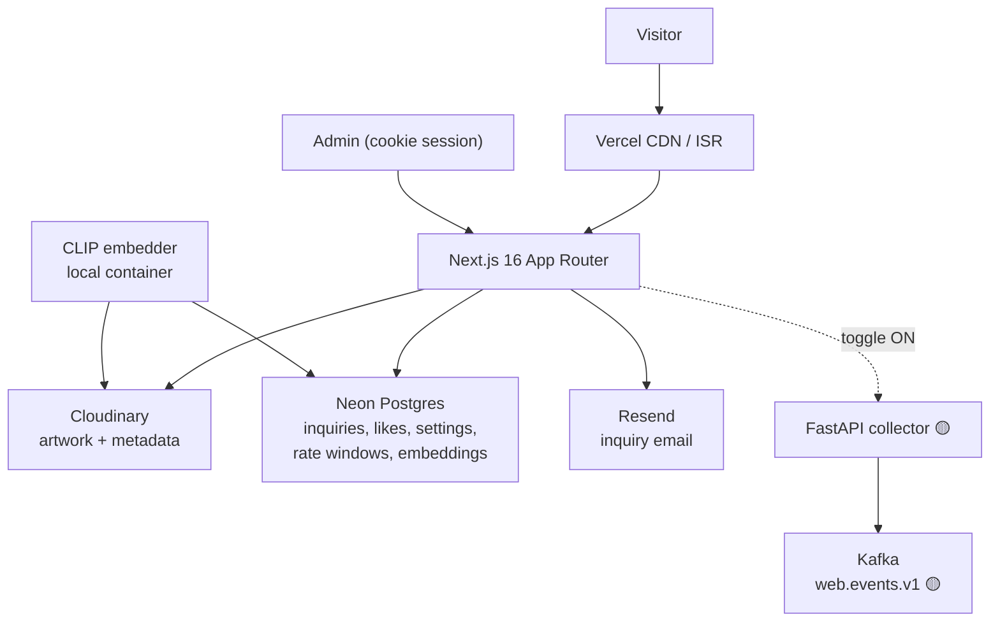
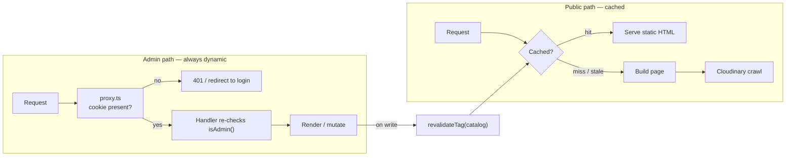
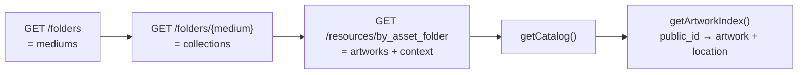
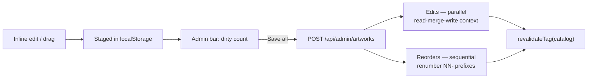
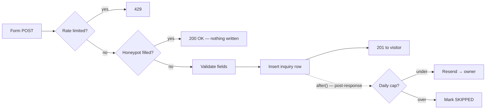
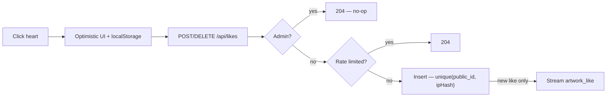
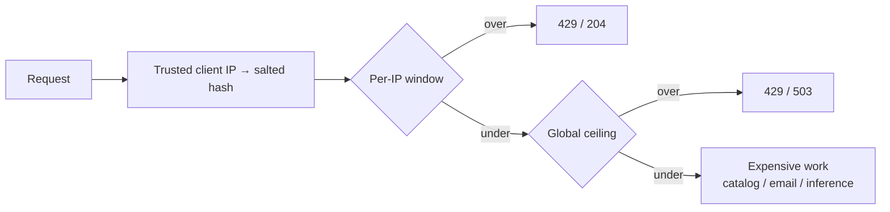
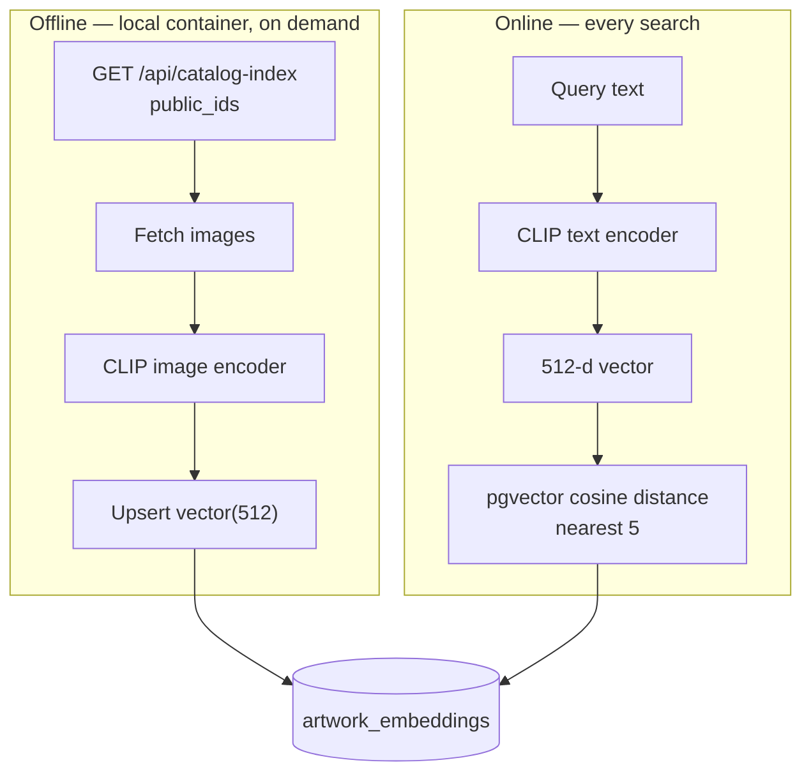
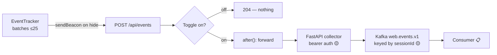

# System overview — saadbhatti.studio

A single-artist portfolio site that grew into a small multi-service system: a Next.js app on
Vercel, Postgres on Neon, Cloudinary as the CMS, and two Python services (a Kafka event
collector and a CLIP image embedder).

This document is a **medium-depth tour** — enough to follow the mechanics and the reasoning
behind them, without being a line-by-line reference.

**Status legend:** ✅ shipped · 🟡 built but not deployed · 📋 planned

> **Related docs.** [README.md](../README.md) is operational (run it, deploy it).
> [docs/architecture.md](architecture.md) and [docs/learnings.md](learnings.md) are the older
> structural and conceptual references — both are stamped "Phase D" and predate the likes,
> settings, events, rate-limiting, and search work, so **this document supersedes them for
> current-state questions**. `learnings.md` §8 (hard-won Cloudinary lessons) is still unique
> and worth reading.

---

## 1. System at a glance

Two bets shaped everything else:

**Bet 1 — the Cloudinary folder tree *is* the site structure.** There is no artwork database
and no CMS. Root folders are mediums, subfolders are collections, images are artworks, and
per-image contextual metadata carries the title and fields. Adding a collection means creating
a folder. The cost is that every structural read is a third-party API call — which is why
caching (§3) matters so much.

**Bet 2 — one app, two regimes.** The public site is statically rendered and cached; the admin
surface is dynamic and cookie-gated, and lives *inline on the same pages* rather than in a
separate dashboard. Much of the design exists to keep the admin half from contaminating the
static half.

### Sources of truth

| Store | Owns | Written by | Read by |
|---|---|---|---|
| **Cloudinary** | Artwork files, titles, metadata, ordering | Admin bulk save; Media Library by hand | Catalog build (hourly ISR) |
| **Neon Postgres** | Inquiries, likes, settings, rate windows, embeddings | API routes; the embedder | Admin pages; search |
| **`content/content.json`** | Site prose (intro, bio, contact) | Hand-edited, compiled into the bundle | Layout, home, about |
| **`public/`** | Hero + headshot images | Hand-placed | Home, about, OG tags |
| **Kafka `web.events.v1`** 🟡 | Raw clickstream | Collector | Future consumer 📋 |
| **`artwork_embeddings`** | 512-d CLIP image vectors | The embedder container | `/api/search` |

---

## 2. Request lifecycle and caching

Three cache layers cooperate:

1. **Fetch-level** — every Cloudinary read is tagged: `next: { revalidate: 3600, tags: ["catalog"] }`
   in [lib/cloudinaryAdmin.ts](../lib/cloudinaryAdmin.ts). One line establishes the whole strategy.
2. **Route-level** — `export const revalidate = 3600` in the root layout.
3. **Per-render** — React `cache()` wraps `getCatalog()` and `getArtworkIndex()` so one request
   crawls Cloudinary at most once.

An admin save calls `revalidateTag("catalog")`, so edits appear immediately instead of waiting
out the hour.

**Why this shows up elsewhere:** keeping the public tree static is a constraint that propagated.
The admin nav is spliced in *client-side* rather than built server-side, because reading the
session in the root layout would make every page dynamic. Admin status is resolved with one
`fetch` to `/api/admin/session` instead — the session cookie is `HttpOnly`, so the client can't
read it directly.

---

## 3. Catalog and Cloudinary-as-CMS ✅

**What it does.** Builds the entire site structure — mediums, collections, artworks, titles,
metadata, ordering — from a Cloudinary account at build/revalidate time.

**How it works.** A recursive crawl in [lib/catalog.ts](../lib/catalog.ts) produces a
medium → collection → artwork tree. Titles come from Cloudinary *contextual metadata*
(`Title Name`), falling back to a prettified filename. Four metadata fields — Film, Medium,
Dimensions, Year — render as the caption line. Ordering is encoded in `NN-` filename prefixes.
`getArtworkIndex()` flattens the tree into a `public_id → {artwork, medium, collection}` map,
which is the join key for every other subsystem.

**Design decisions.**
- **`public_id` is the only stable artwork key.** Titles, filenames, and folders can all change;
  `public_id` never does. Every foreign reference in Postgres — inquiries, likes, embeddings —
  stores that and nothing else.
- **Image delivery is Cloudinary's job, not Next's.** A raw `` with hand-built URLs
  (`f_auto,q_auto,c_limit` capped at 2048px, a four-width `srcset`, and a 16px blurred
  placeholder as a CSS background) rather than `next/image`, since the CDN already does the
  optimization. Originals never leave Cloudinary.
- **Layout space is reserved from the real aspect ratio** to prevent layout shift, and image
  width is capped so a tall portrait still leaves its caption on screen.

**Key files:** [lib/catalog.ts](../lib/catalog.ts) · [lib/cloudinary.ts](../lib/cloudinary.ts) ·
[lib/artworkFields.ts](../lib/artworkFields.ts) · [components/ArtworkImage.tsx](../components/ArtworkImage.tsx)

---

## 4. Admin editing and auth ✅

**What it does.** Lets the owner edit titles/metadata and drag-reorder artworks *inline on the
public pages*, staging changes locally until an explicit bulk save.

**How it works.** Auth is a single sealed cookie via `iron-session` — there is **no user table
and no session store**; the encrypted cookie *is* the session, and unsealing it is the
verification. [proxy.ts](../proxy.ts) checks only that the cookie *exists*.

Editing state lives in `localStorage` and in React **refs**, not state — mutating a ref doesn't
re-render, so typing in a caption doesn't re-render the page. Three integer counters are the only
re-render triggers, each feeding a separate context so unrelated components don't churn.

**Design decisions.**
- **The proxy is not a security boundary.** It's a latency optimization that checks cookie
  presence; `isAdmin()` is re-checked authoritatively inside every protected handler, page, and
  Server Action. (It also keeps `bcryptjs` out of the edge bundle.)
- **Cloudinary's context API replaces rather than merges**, discovered empirically — so writes
  do read-merge-write against fresh state, preserving keys the app doesn't manage.
- **Reorder is a bulk rename, so it refuses to guess.** It re-reads live membership first and
  aborts if the set has drifted, rather than merging into a destructive operation. Writes are
  sequential and skip no-ops, making retries idempotent and self-healing.
- **Failed items stay staged.** A partial save keeps exactly the failures in `localStorage` so
  a retry resolves them.

**Key files:** [lib/auth.ts](../lib/auth.ts) · [proxy.ts](../proxy.ts) ·
[components/AdminProvider.tsx](../components/AdminProvider.tsx) ·
[lib/cloudinaryAdmin.ts](../lib/cloudinaryAdmin.ts) · [lib/artworkFields.ts](../lib/artworkFields.ts)

---

## 5. Inquiries and email notifications ✅

**What it does.** A per-artwork contact form that stores the inquiry and emails the owner.

**How it works.** A per-IP limit (5 per 10 minutes) is checked first, before anything that could
distinguish a bot from a real visitor — so a bot that keeps the hidden honeypot field filled is
still capped rather than exempt (tech-debt.md 3.8). Only requests under budget reach the honeypot
check, then field validation against shared bounds (name 100, email 254, message 2000). The
artwork title is resolved server-side from the catalog and **snapshotted** onto the row. The email
is dispatched *after* the response is flushed, and each row records its own outcome —
`PENDING / SENT / SKIPPED / FAILED` plus the error text.

**Design decisions.**
- **The lead is never lost to a mail failure.** The row is committed before the send is
  attempted, and the send runs in `after()` where it cannot fail the submission. An un-emailed
  inquiry surfaces an alert in the admin log with the stored error and a one-click resend, so a
  silent drop becomes a visible, recoverable state.
- **Snapshot over join.** Storing the title means the log survives renames and deletions — and
  a client-supplied title never reaches the admin page, closing an injection path.
- **Terse, uniform errors.** The honeypot mimics success *exactly* (same status, same body) —
  but only once the request has cleared the rate limit, so the mimicry can't be used to dodge it.
  Bots learn nothing from probing.
- **A global daily send cap** bounds cost even when a distributed flood keeps every individual
  IP under the per-IP limit. Over the cap, inquiries still save; only the email is skipped.

**Key files:** [app/api/inquiries/route.ts](../app/api/inquiries/route.ts) ·
[lib/mail.ts](../lib/mail.ts) · [app/admin/comments/](../app/admin/comments/)

---

## 6. Likes ✅

**What it does.** An anonymous, idempotent like/unlike on each artwork — the one explicit
interest signal.

**How it works.** Dedup is a database **unique constraint** on `(artworkPublicId, ipHash)` — a
duplicate raises a constraint error that is caught and turned into a normal `204`, so liking
twice is harmless. The IP is stored only as a salted SHA-256 hash; the raw address is never
persisted. Admin likes are suppressed server-side. Only a genuinely new like emits an event.

**Design decision — a unique constraint is not a rate limit.** It caps stored *rows*, not
request volume: a script could still hammer the endpoint, and every duplicate insert costs a
round trip. That gap is exactly what §7 closes.

**Key files:** [app/api/likes/route.ts](../app/api/likes/route.ts) ·
[components/LikeButton.tsx](../components/LikeButton.tsx)

---

## 7. Security and rate limiting ✅

**What it does.** Protects three public write endpoints against floods and abuse — invisibly,
with no CAPTCHA on the happy path.

**The bug that motivated it.** The client IP was read from the *leftmost* `x-forwarded-for`
entry — the client-appended, spoofable end of the chain. Rotating one header per request minted
a fresh bucket every time, defeating the inquiry limiter and the like dedup entirely. The fix
trusts only platform-set headers and, failing that, the *rightmost* hop.

**How it works.** One shared helper backed by a `rate_windows` table: a fixed window per
`(bucket, ip_hash, window_start)`, incremented with an atomic upsert.

**Design decisions.**
- **Postgres, not in-memory.** On serverless every invocation is a fresh instance, so in-process
  counters are useless. Postgres is the only shared state — and no new infrastructure.
- **Count requests, not rows.** Domain rows don't generalize: a deduped like, a DELETE, and an
  events forward all produce no row. A dedicated counter covers them.
- **Fail *open*.** If the limiter's own query fails, the request proceeds — *"a flood is a
  lesser harm than an outage."*
- **Cheapest checks first.** Ordering is load-bearing on `/api/search`: capped body read →
  parse → raw-length bound → sanitize → per-IP → global → *only then* run ML inference, so an
  oversized or throttled request never reaches the expensive step (or even a full sanitize pass).
- **Per-IP plus global.** Per-IP is a fairness control; it can't see a botnet. Global ceilings
  bound total cost for the two paths that cost real money — email sends and inference.

**Key files:** [lib/rateLimit.ts](../lib/rateLimit.ts) · [lib/inquiries.ts](../lib/inquiries.ts)

**Not done:** edge/WAF filtering. A request still costs a function invocation even when it 429s
fast; absorbing a truly volumetric flood needs a rule at the edge.

---

## 8. Semantic image search ✅

**What it does.** A visitor types a description — "moody blue rooftops at dusk" — and gets the
five best-matching artworks, ranked by what the images *look like*, not by their titles.

**Why CLIP.** Artwork text is thin — titles are often filename-derived and there are no
descriptions — so there was almost nothing to match against. CLIP maps *images and text into one
shared vector space*, so a typed phrase can be compared directly against image content. It's
pre-trained; nothing is trained here.

**The split.** Image encoding is heavy and rare, so it runs offline in a container and writes
vectors to Postgres. Text encoding is light and per-request, so it runs in the search function.
The two halves are different languages (PyTorch / transformers.js) but meet as 512-d vectors —
which only works because both are pinned to the *same* CLIP variant. That **model parity** is
enforced by baking the model into the embedder image, not by convention.

**Design decisions.**
- **Not Elasticsearch.** ES vector search earns its keep at millions of vectors with ANN
  indexes. This corpus is dozens. Adding an ES node — let alone co-locating one on a
  free-tier 1 GB box — would have been a container ship on a pond.
- **pgvector on the existing database.** No new infrastructure, and refreshes are deploy-free:
  the embedder writes to Neon and search sees the vectors immediately. An exact scan over dozens
  of rows is instant; an ANN index can come later.
- **A similarity floor.** With ten artworks, a top-5 query *always* returns five — even for
  nonsense. A minimum cosine score makes "no good match" an expressible answer.
- **Machine clients authenticate differently.** The embedder reads `/api/catalog-index`, which
  sits *outside* `/api/admin` with bearer-token auth, because a container has no browser cookie.

**The scars — useful ones.** Getting this onto serverless took three infrastructure fights:
Vercel traced the native ONNX addon but not the shared library it `dlopen()`s; the fix had to
ship four specific files while *excluding* a 327 MB CUDA provider that would have blown the
250 MB function limit on its own. Locally, Docker 28+ blocks container→host traffic by default,
so the embedder runs on the host network. Cold starts still pay for loading the model.

**Escape hatches, by design.** Encoding is isolated behind one module, so swapping to a hosted
embedding API — or moving query encoding into a long-lived container, which would erase cold
starts entirely — changes one function and leaves the store, API, and UI untouched.

**Key files:** [lib/clip.ts](../lib/clip.ts) · [app/api/search/route.ts](../app/api/search/route.ts) ·
[embed/main.py](../embed/main.py) · [components/SearchDrawer.tsx](../components/SearchDrawer.tsx)

**Running the embedder:** see [docs/operations.md §1](operations.md#1-re-indexing-search) for
when to re-run it and how — including drift detection for when a re-run has been missed.

**Live status:** merged to `main`. The ONNX packaging fix is deployed but end-to-end production
search has not yet been confirmed, and `MIN_SCORE` still needs tuning against real queries.

---

## 9. Kafka event streaming — K1 ✅ · K2 🟡 · K3 📋

**What it does.** Captures a visitor clickstream (page views, artwork views, intent gestures)
into a Kafka topic, as a foundation for analytics.

**How it works.** The client batches events and flushes them with `sendBeacon` on page hide, so
they survive unload. The endpoint is gated by a database toggle that is **off by default** and
**always returns 204**. Forwarding happens in `after()`. The collector is the single
bearer-authenticated door; Kafka's port is never exposed. Events are keyed by `sessionId` so one
visit lands in one partition and stays ordered.

**Design decisions.**
- **HTTP collector in front of Kafka.** Kafka has no authentication by default, so exposing a
  broker to the internet was never an option. A small FastAPI service authenticates and produces.
- **Fail *closed* here** — the exact opposite of the rate limiter. If the toggle read fails,
  streaming turns off. The rule underneath both: *degrade toward the site staying up and the
  optional feature staying off.*
- **`acks=1`, not `all`** — "learning data, not financial records." Latency over durability, but
  a brief flush before returning so a crash right after the 204 doesn't silently drop a batch.
- **Likes are durable independently.** They're a Postgres row, not a stream event, so the heart
  is honest whether streaming is on or off.
- **What was deliberately *not* built:** routing inquiry emails through Kafka. It was considered
  and rejected — a queue for a handful of daily emails is résumé-driven architecture, not a
  real fit.

**Status detail.** K1 (capture + local Kafka via Docker) works. K2 — the EC2 deployment — is
**scaffolded but not deployed**: `deploy/` holds the compose file, Caddy TLS config, and a
runbook, and the target is a free-tier box with a pinned 256 MB JVM heap and a required swap
file. K3, the consumer, is unstarted.

**Key files:** [components/EventTracker.tsx](../components/EventTracker.tsx) ·
[app/api/events/route.ts](../app/api/events/route.ts) · [lib/collector.ts](../lib/collector.ts) ·
[collector/main.py](../collector/main.py) · [deploy/](../deploy/)

---

## 10. Patterns that recur

| Pattern | Where | Why |
|---|---|---|
| **Fail-open vs fail-closed** | Rate limiter fails *open*; streaming toggle fails *closed* | Degrade toward: site up, optional feature off |
| **Best-effort `after()`** | Email, event forwarding | The user's action is already committed; a side effect must never fail it |
| **Terse public errors** | Inquiries, likes, events, search | Uniform responses; the honeypot mimics success exactly |
| **Snapshot over join** | Inquiry artwork title | Survives renames; blocks client-supplied text reaching admin UI |
| **Stable `public_id` only** | Every cross-store reference | The one identifier that never changes |
| **Bearer for machines, cookies for browsers** | `/api/catalog-index` | A container has no session cookie |
| **Server-only vs client-safe modules** | `inquiryLimits` vs `inquiries`; `cloudinary` vs `cloudinaryAdmin` | Shared constants without dragging Prisma or secrets into the browser bundle |
| **Instructional config errors** | Auth, IP salt, Cloudinary | Throw the remediation steps, not just "undefined" |

---

## 11. Data model

Five tables, all referencing artworks by Cloudinary `public_id`:

| Table | Holds |
|---|---|
| `inquiries` | Contact submissions + snapshotted artwork title + email outcome |
| `likes` | One row per (artwork, IP hash) — the unique constraint *is* the dedup |
| `settings` | Generic key/value flags; currently the streaming toggle |
| `rate_windows` | Fixed-window request counters per (bucket, IP hash, window) |
| `artwork_embeddings` | 512-d CLIP vectors — `vector(512)`, reached only via raw SQL since Prisma has no vector type |

The migration names double as a project timeline: `init_inquiries` → `add_settings_and_likes` →
`add_rate_windows` → `add_inquiry_email_status` → `add_artwork_embeddings`.

---

## 12. Environments and deployment

- **Site** — Vercel; push to `main` builds and deploys. No pipeline file.
- **Database** — Neon. Pooled URL at runtime, direct URL for migrations. **Migrations are run
  manually**, deliberately decoupled from the build, so a deploy never needs database access.
- **Media** — Cloudinary; the Admin API is used for both reads and metadata writes.
- **Local** — Docker Compose with three profiles: `db` always on, `streaming` (Kafka + collector)
  and `embedding` (CLIP) opt-in, so day-to-day development starts only Postgres.
- **Streaming box** 🟡 — a documented but unprovisioned EC2 target; Caddy terminates TLS and only
  it is publicly reachable.

Configuration is split deliberately: database URLs in `.env` (the Prisma CLI reads only that
file), everything else in `.env.local` and Vercel. Every optional integration degrades rather
than crashing when unset — with mail unconfigured, inquiries still save.

---

## 13. Testing and verification — honestly

**There are no automated tests and no CI.** Verification today is:

- TypeScript plus `next build` — including a route-table check that public routes stay static
  (`○`/`●`) and admin routes stay dynamic (`ƒ`), which is how the core static-site invariant is
  defended.
- Manual runbooks written into the planning docs, with explicit negative tests (the deployment
  runbook requires confirming the Kafka port is *unreachable*).
- Behaviors that were verified empirically once and recorded in code comments — Cloudinary's
  context-replace semantics, for instance.

That's a real gap, stated plainly. The first tests worth writing: the rate limiter's window
arithmetic, the inquiry pipeline's ordering (limit → honeypot → validation → row → email), and
the search route's sanitization and floor.

---

## 14. Known limitations and what's next

- **Search cold starts** — the first query on a cold function loads an ONNX model. A long-lived
  container would remove this entirely.
- **Embedding freshness** — new artwork is invisible to search until the embedder is re-run
  manually; auto-reindex on catalog change is the obvious next step.
- **No edge/WAF layer** — code-level limits can't absorb a volumetric flood.
- **K2/K3 unbuilt** — events stream locally only; nothing consumes the topic yet.
- **No CI** — see §13.
- **Containerization** — the direction is to containerize each service; the embedder and
  collector already are. Moving the site itself would erase the serverless constraints described
  above, at the cost of leaving Vercel's managed platform.
